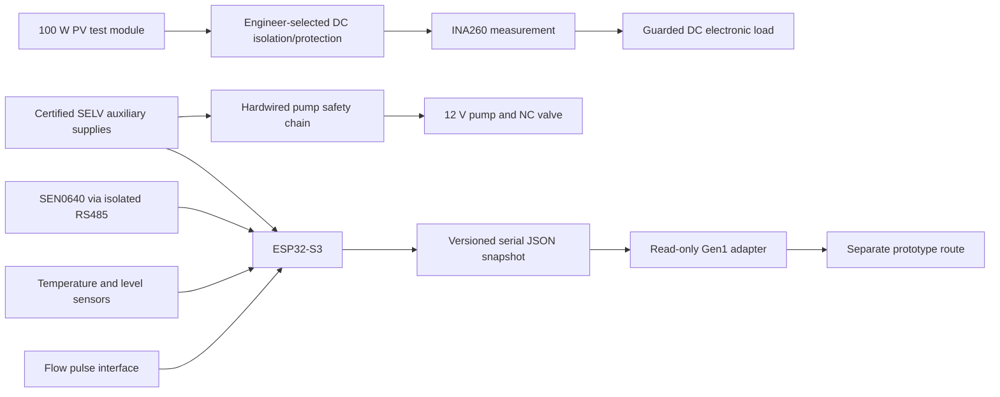

# System architecture

Status: design/specification only, 27 November 2026. No physical prototype has been assembled, energized or tested. Independent engineering review is required before procurement release and assembly.

The diagram is a functional boundary, not a wiring instruction or certified schematic. Qualified engineering design must settle isolation/common reference, DC-rated fuses/disconnects, conductor size, short-circuit path, pulse input protection and MOSFET/relay failure modes. INA260 has a vendor 36 V maximum; the rig has a stricter <=30 V cold Voc limit. High-current load/heat lives outside wet areas. No breadboard carries the PV load or pump power.

## Commercial boundary

A separately certified inverter owns grid synchronization, anti-islanding and export limitation. A qualified EPC designs DC strings, earthing, AC protection and utility interfaces. welOS initially reads supported telemetry through a documented read-only interface. Neither browser nor ESP32 is primary electrical protection. The existing twin uses 48 V storage abstractions and remains a demonstration, not a wiring specification for this rig.

## Data boundary

Retain existing `src/control`, `src/twin` and firmware untouched. `src/gen1/config.js` reuses sizing and monthly economics. `dispatch.js` provides an isolated synthetic instantaneous power balance. `telemetry.js` imports hardware snapshots with explicit provenance and no command channel. `hardware/gen1/TELEMETRY_CONTRACT.md` specifies the boundary. Integration is software-ready; sensor drivers, a verified pin map, firmware port and physical logging still need implementation and bench testing before hardware operation.
